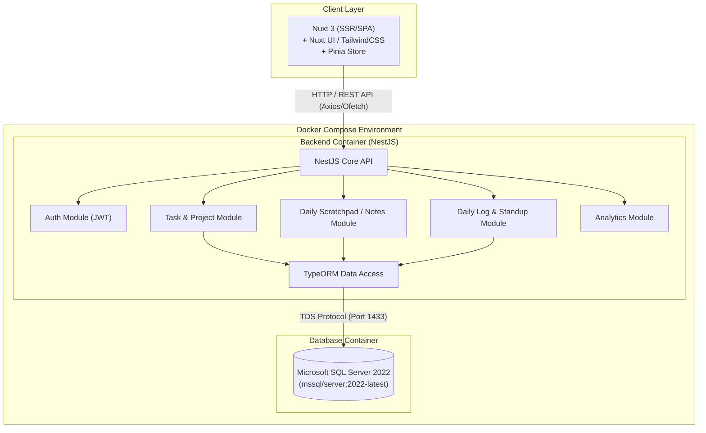
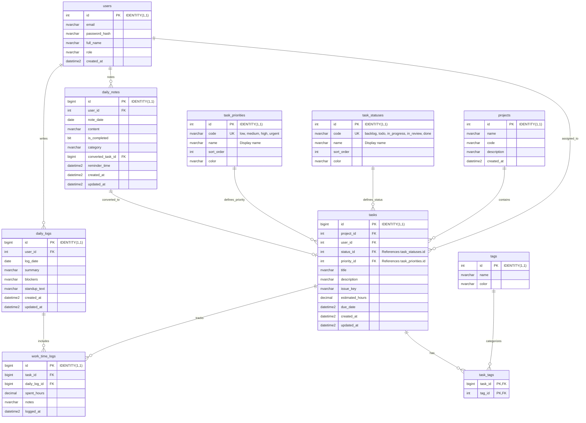

# Implementation Plan: Developer Daily Task & Work Log System

ระบบจดบันทึกและจัดการงานประจำวันของ Developer (Daily Task Planner, Standup Work Log & Memory Scratchpad) พัฒนาด้วย **Nuxt 3 (Frontend)**, **NestJS (Backend)**, **Microsoft SQL Server (MSSQL)** และ **Docker Compose**.

---

## 1. Goal Description

เป้าหมายคือการสร้างเว็บแอปพลิเคชันสำหรับ Developer และทีมพัฒนาซอฟต์แวร์ เพื่อ:
1. **บันทึกความจำและเตือนกันลืมประจำวัน (Daily Scratchpad & Quick Reminders)**: บันทึกช่วยจำ (Note-to-Self) สิ่งที่ต้องทำในแต่ละวัน เช่น เช็ค PR, ทดสอบระบบ staging บ่ายสาม, สิ่งที่ต้องคุยกับเพื่อนร่วมทีม, บันทึกเตือนความจำทั้งแบบ Checklist และ Free-form Note พร้อมฟังก์ชันแปลงเป็น Task ทางการได้ในคลิกเดียว (Convert to Task)
2. **วางแผนงานประจำวัน (Daily Planning)**: วางแผนว่าวันนี้ต้องทำอะไร จัดลำดับความสำคัญ (Priority) และประมาณการเวลา (Estimated Hours)
3. **บันทึกความคืบหน้าระหว่างวัน (Work & Time Logging)**: บันทึกเวลาที่ใช้จริง (Spent Hours) และอัปเดตสถานะงาน (`backlog`, `todo`, `in_progress`, `in_review`, `done`)
4. **สรุป Daily Standup อัตโนมัติ (Automated Standup Generator)**: รวบรวมข้อมูล "สิ่งที่ทำไปเมื่อวาน", "สิ่งที่ทำวันนี้", และ "ปัญหา/ติดขัด (Blockers)" ในรูปแบบ Markdown/Text พร้อมปุ่มกดคัดลอกลง Slack, Discord หรือ Microsoft Teams ทันที
5. **ภาพรวมระดับทีม (Team Dashboard)**: หัวหน้าทีม (Tech Lead / PM) สามารถดูภาพรวมงานของ Developer ทุกคนในแต่ละวันได้

---

## 2. User Review Required

> [!IMPORTANT]
> **การกำหนด Primary Key (PK) เป็นตัวเลข (Numeric ID)**:
> ปรับโครงสร้างตารางทุกตารางในฐานข้อมูล MSSQL ให้ใช้ **Primary Key เป็นตัวเลขแบบ Auto-increment (`int` หรือ `bigint IDENTITY(1,1)`)**:
> - ตาราง Master (`task_statuses`, `task_priorities`, `users`, `projects`, `tags`): ใช้ `int IDENTITY(1,1)`
> - ตาราง Transaction (`tasks`, `daily_notes`, `daily_logs`, `work_time_logs`): ใช้ `bigint IDENTITY(1,1)`
> - ในตาราง `task_statuses` และ `task_priorities` จะมีคอลัมน์ `code` เป็นตัวพิมพ์เล็ก (lowercase เช่น `'backlog'`, `'todo'`, `'low'`, `'medium'`) เพื่อให้โค้ดฝั่งแอปพลิเคชันและ Frontend เรียกใช้งานได้อย่างชัดเจน

> [!NOTE]
> **การรัน MSSQL บน Docker**:
> MSSQL บน Docker ต้องการสเปกขั้นต่ำของ container แนะนำ RAM อย่างน้อย 2GB และรหัสผ่าน `SA_PASSWORD` ต้องมีความซับซ้อนตามนโยบายความปลอดภัยของ Microsoft (ตัวพิมพ์ใหญ่ เล็ก ตัวเลข และสัญลักษณ์)

---

## 3. System Architecture & Diagram



---

## 4. Database Schema (MSSQL) - Numeric Primary Keys



### รายละเอียดตารางและข้อมูลเริ่มต้น (Seed Data):

#### 1. ตาราง `task_statuses` (Master Table สถานะงาน):
| id (PK, int) | code (lowercase) | name | sort_order | color |
| :--- | :--- | :--- | :--- | :--- |
| **1** | `backlog` | Backlog | 1 | `#94a3b8` (Slate) |
| **2** | `todo` | To Do | 2 | `#3b82f6` (Blue) |
| **3** | `in_progress` | In Progress | 3 | `#f59e0b` (Amber) |
| **4** | `in_review` | In Review | 4 | `#a855f7` (Purple) |
| **5** | `done` | Done | 5 | `#10b981` (Emerald) |

#### 2. ตาราง `task_priorities` (Master Table ระดับความสำคัญ):
| id (PK, int) | code (lowercase) | name | sort_order | color |
| :--- | :--- | :--- | :--- | :--- |
| **1** | `low` | Low | 1 | `#64748b` (Slate) |
| **2** | `medium` | Medium | 2 | `#3b82f6` (Blue) |
| **3** | `high` | High | 3 | `#ea580c` (Orange) |
| **4** | `urgent` | Urgent | 4 | `#ef4444` (Red) |

#### 3. ตาราง `tasks`:
- `id`: เป็น `bigint IDENTITY(1,1)`
- `status_id`: เป็น `int` (Foreign Key เชื่อมกับ `task_statuses.id`)
- `priority_id`: เป็น `int` (Foreign Key เชื่อมกับ `task_priorities.id`)

---

## 5. API Design (NestJS)

| Endpoint | Method | คำอธิบาย |
| :--- | :--- | :--- |
| `/api/auth/register` | POST | ลงทะเบียนผู้ใช้งาน |
| `/api/auth/login` | POST | เข้าสู่ระบบ และรับ JWT Token |
| `/api/auth/profile` | GET | ดึงข้อมูลผู้ใช้ปัจจุบัน |
| `/api/task-statuses` | GET | ดึงรายการสถานะทั้งหมด (id, code, name, sort_order, color) |
| `/api/task-priorities` | GET | ดึงรายการความสำคัญทั้งหมด (id, code, name, sort_order, color) |
| `/api/daily-notes` | GET / POST | ดึงโน้ตช่วยจำตามวันที่ (`?date=YYYY-MM-DD`) / เพิ่มโน้ตช่วยจำใหม่ |
| `/api/daily-notes/:id` | PATCH / DELETE | สลับสถานะทำแล้ว (toggle `is_completed`), แก้ไขข้อความ หรือลบโน้ต (`:id` เป็นตัวเลข) |
| `/api/daily-notes/:id/convert-to-task` | POST | แปลงโน้ตเตือนความจำให้กลายเป็น Task ทางการใน Project |
| `/api/projects` | GET / POST | ดึงรายชื่อหรือสร้าง Project |
| `/api/tasks` | GET / POST | ดึงรายการ Task (กรองตาม date, status_id, project_id) / สร้าง Task ใหม่ |
| `/api/tasks/:id` | GET / PATCH / DELETE | ดูรายละเอียด, อัปเดตสถานะ (`status_id`) หรือลบ Task (`:id` เป็นตัวเลข) |
| `/api/daily-logs/today` | GET | ดึง Daily Log ของวันปัจจุบัน (พร้อม Tasks & Time logs) |
| `/api/daily-logs/standup` | GET | สร้างข้อความ Standup Summary (Yesterday, Today, Blockers) |
| `/api/daily-logs/blockers` | POST | บันทึกปัญหา/อุปสรรคประจำวัน |
| `/api/time-logs` | POST | บันทึกเวลาที่ใช้ไปกับ Task |
| `/api/team/overview` | GET | สำหรับ Lead: ดูสรุปงานประจำวันของลูกทีมทุกคน |

---

## 6. Frontend UI/UX Design (Nuxt 3)

### ฟังก์ชันและหน้าจอหลัก:
1. **Today's Workspace (หน้าหลักของ Dev)**:
   - **Focus Header**: แสดงวันที่ปัจจุบัน สรุปจำนวนสิ่งที่ต้องทำ และเวลาทำงานรวมของวันนี้
   - **Daily Scratchpad & Quick Reminders (แผงบันทึกความจำกันลืม)**:
     - แผงจดด่วนสำหรับ Developer: พิมพ์สิ่งที่ต้องทำสั้นๆ กด Enter เพื่อสร้างทันที
     - ติ๊กถูกเมื่อทำเสร็จแล้ว (Strike-through text)
     - ปุ่ม "Convert to Task": หากโน้ตนั้นกลายเป็นงานชิ้นใหญ่ สามารถคลิกแปลงไปเป็น Task ในโปรเจกต์ได้ทันที
     - ตัวกรอง: แสดงเฉพาะที่ยังไม่เสร็จ (Uncompleted) / ทั้งหมด (All)
   - **Daily Task Checklist**: รายการงานทางการที่วางแผนไว้สำหรับวันนี้ มี Badge แสดงสถานะและ Priority จากตาราง Master พร้อมเปลี่ยนสถานะเป็น `done` (id: 5) ได้ง่าย
   - **Quick Add Task**: กล่องพิมพ์ชื่องานด่วน พร้อมเลือก Project, Priority (เลือกจาก Dropdown ที่ดึงจาก `task_priorities`) และเวลาประมาณการ
   - **Blockers Section**: ช่องพิมพ์บันทึกปัญหาที่กำลังติดขัดอยู่ (e.g. รอ API จากอีกทีม, ติด Permission)
2. **Daily Standup Assistant (ตัวช่วยรายงานประจำวัน)**:
   - สรุปงานอัตโนมัติ 3 ช่อง:
     1. **Yesterday**: ดึงงานที่เสร็จสิ้นจากเมื่อวาน (`status_id = 5` หรือ code `done`)
     2. **Today**: ดึงงานและบันทึกช่วยจำที่กำลังทำหรือวางแผนจะทำวันนี้ (`todo`, `in_progress`)
     3. **Blockers**: สิ่งที่บันทึกว่าติดขัด
   - ปุ่ม **"Copy for Slack / Teams"** เพื่อคัดลอกข้อความเป็น Markdown ทันที
3. **Kanban Board / Task Backlog**:
   - ลากวาง (Drag-and-drop) การ์ดงานระหว่างคอลัมน์สถานะตามตาราง `task_statuses`:
     `backlog` (1) ➔ `todo` (2) ➔ `in_progress` (3) ➔ `in_review` (4) ➔ `done` (5)
4. **Time & History Reports**:
   - กราฟสรุปเวลาการทำงานย้อนหลัง (เช่น วันนี้เขียนโค้ด 4 ชม., ประชุม 2 ชม., แก้บั๊ก 1 ชม.)

---

## 7. โครงสร้างโปรเจกต์ (Project Structure)

```text
dev-daily-task-system/
├── docker-compose.yml
├── .env.example
├── backend/                  # NestJS Project
│   ├── Dockerfile
│   ├── src/
│   │   ├── config/          # TypeORM & Environment config
│   │   ├── database/
│   │   │   └── seeds/       # Seeder สำหรับ task_statuses และ task_priorities (id ตัวเลข & code พิมพ์เล็ก)
│   │   ├── modules/
│   │   │   ├── auth/            # JWT Authentication
│   │   │   ├── users/           # User management
│   │   │   ├── projects/        # Project management
│   │   │   ├── task-lookups/    # Statuses & Priorities master API
│   │   │   ├── tasks/           # Tasks CRUD & Status updates
│   │   │   ├── daily-notes/     # Daily Scratchpad & Reminders
│   │   │   ├── daily-logs/      # Daily logs & Standup generator
│   │   │   └── time-logs/       # Work hours tracking
│   │   ├── app.module.ts
│   │   └── main.ts
│   └── package.json
└── frontend/                 # Nuxt 3 Project
    ├── Dockerfile
    ├── app.vue
    ├── nuxt.config.ts
    ├── components/
    │   ├── DailyNotesWidget.vue # แผงบันทึกเตือนความจำกันลืม (Scratchpad)
    │   ├── DailyStandupModal.vue
    │   ├── TaskCard.vue
    │   └── QuickTaskInput.vue
    ├── pages/
    │   ├── index.vue        # Today's Workspace
    │   ├── board.vue        # Kanban Board (5 columns: 1..5)
    │   ├── history.vue      # Past daily logs
    │   └── login.vue
    ├── composables/         # useApi, useAuth, useTasks, useDailyNotes, useLookups
    └── stores/              # Pinia Stores (auth, task, dailyNote, dailyLog, lookup)
```

---

## 8. Docker Compose Configuration (Preview)

```yaml
version: '3.8'

services:
  mssql:
    image: mcr.microsoft.com/mssql/server:2022-latest
    container_name: devtasks-mssql
    environment:
      ACCEPT_EULA: "Y"
      MSSQL_SA_PASSWORD: "YourStrong@Password123"
      MSSQL_PID: "Developer"
    ports:
      - "1433:1433"
    volumes:
      - mssql_data:/var/opt/mssql/data
    networks:
      - devtasks-net

  backend:
    build:
      context: ./backend
      dockerfile: Dockerfile
    container_name: devtasks-backend
    environment:
      DB_HOST: mssql
      DB_PORT: 1433
      DB_USER: sa
      DB_PASSWORD: "YourStrong@Password123"
      DB_NAME: DevTasksDB
      JWT_SECRET: "super-secret-jwt-key"
      PORT: 3001
    ports:
      - "3001:3001"
    depends_on:
      - mssql
    networks:
      - devtasks-net

  frontend:
    build:
      context: ./frontend
      dockerfile: Dockerfile
    container_name: devtasks-frontend
    environment:
      NUXT_PUBLIC_API_BASE: "http://localhost:3001/api"
      PORT: 3000
    ports:
      - "3000:3000"
    depends_on:
      - backend
    networks:
      - devtasks-net

volumes:
  mssql_data:

networks:
  devtasks-net:
    driver: bridge
```

---

## 9. Verification Plan

### Automated Tests
1. **Backend Unit/E2E Tests**:
   - `npm run test` ใน NestJS เพื่อทดสอบ Service logic (Numeric IDs, Lookup seeders, Task status transitions, Daily Notes, Standup formatting)
   - `npm run test:e2e` เพื่อทดสอบ REST API endpoints
2. **Frontend Type-check**:
   - `npx nuxi typecheck` เพื่อตรวจสอบ TypeScript types ใน Nuxt 3

### Manual Verification
1. **Database Readiness**:
   - ตรวจสอบว่าตารางทุกตารางสร้าง Primary Key เป็นตัวเลข (`IDENTITY(1,1)`)
   - ตรวจสอบว่าตาราง `task_statuses` (id: 1..5) และ `task_priorities` (id: 1..4) มีข้อมูลตัวพิมพ์เล็กครบถ้วน
2. **End-to-End Workflow**:
   - ตรวจสอบการสร้าง Task และอัปเดตสถานะด้วย `status_id` ที่เป็นตัวเลข
   - ตรวจสอบการบันทึก Daily Note และแปลงเป็น Task
   - ตรวจสอบการกด Generate Daily Standup
